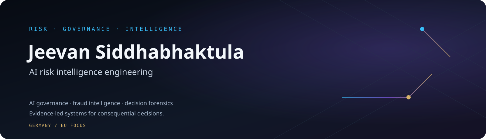
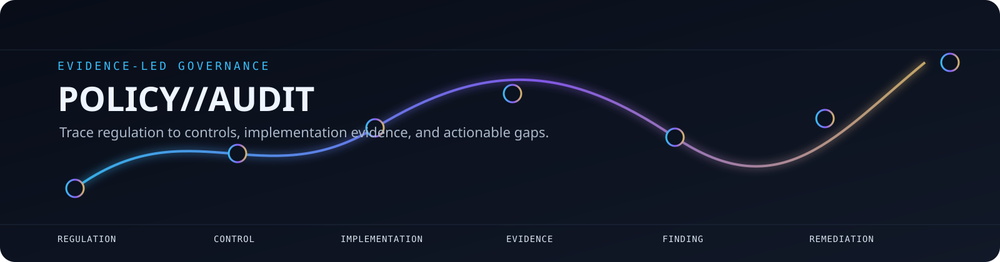
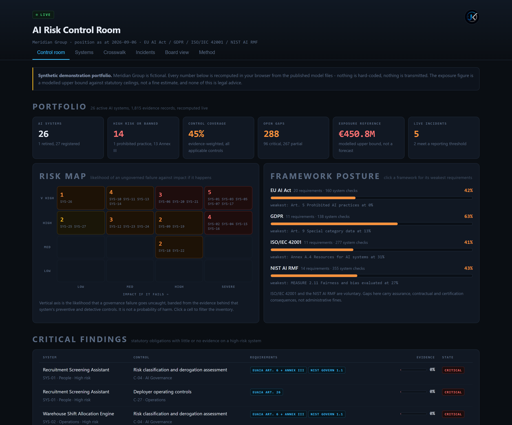
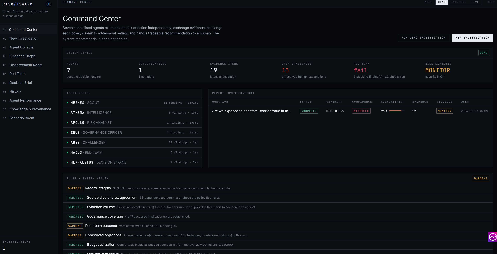
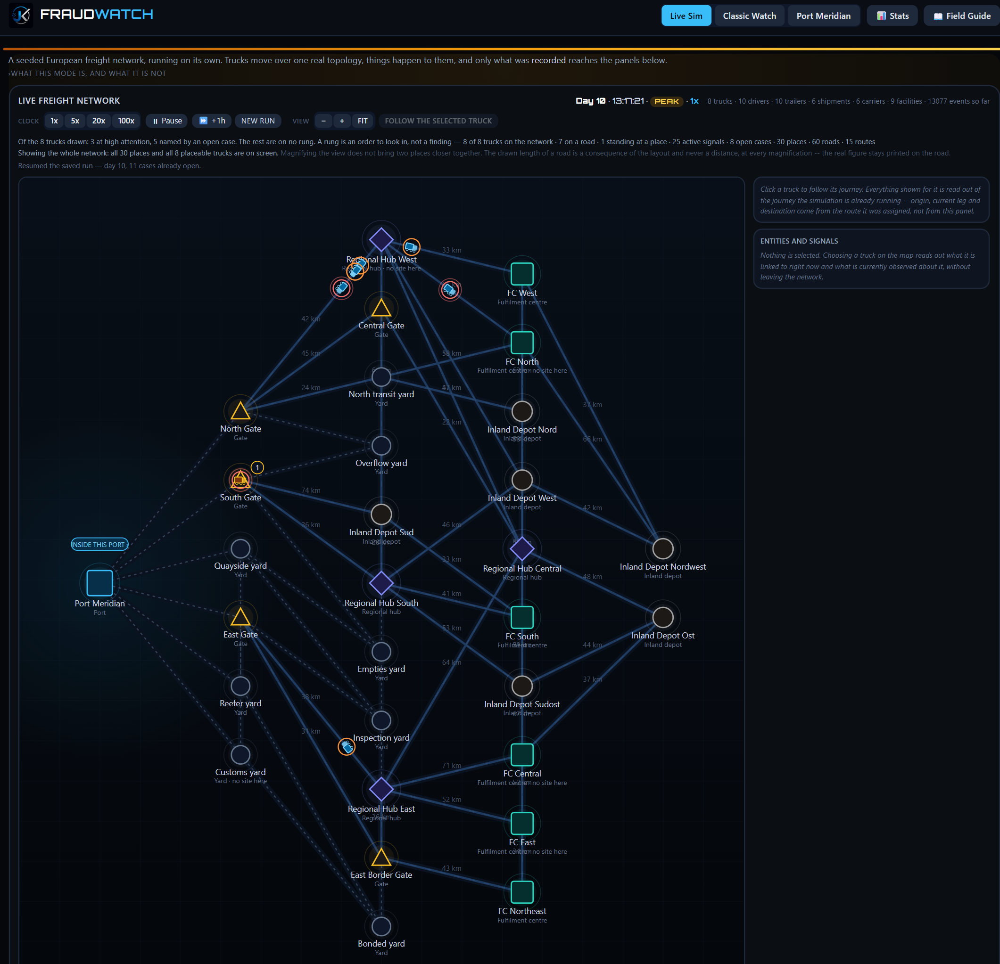

  

  <a href="https://jeevan-0508.github.io">Portfolio</a> ·
  <a href="https://www.linkedin.com/in/jeevan-siddhabhaktula-6927041a2/">LinkedIn</a> ·
  <a href="mailto:jeevansiddhabhaktula@gmail.com">Email</a> ·
  <a href="docs/PROJECT-CATALOG.md">Project catalog</a> ·
  <a href="docs/PORTFOLIO-AUDIT.md">Portfolio audit</a>

# Building systems that make consequential decisions easier to inspect

I’m a former Amazon Risk and Compliance Program Manager working at the intersection of **AI governance,
responsible AI, GRC, fraud intelligence, logistics risk, and operational automation**.

My independent portfolio turns those problem spaces into inspectable software, simulations, evidence
workflows, and decision-support prototypes. Each project states what is real, simulated, snapshot-based,
or still planned.

\`AI GOVERNANCE\` · \`RISK INTELLIGENCE\` · \`FRAUD SYSTEMS\` · \`LOGISTICS SECURITY\` · \`GERMANY / EU\`

## Start here

| If you are hiring for… | Start with… | What it demonstrates |
| --- | --- | --- |
| AI governance / responsible AI | [POLICY//AUDIT](https://github.com/Jeevan-0508/policy-audit) · [AI Governance Control Room](https://github.com/Jeevan-0508/ai-governance-control-room) | Evidence chains, framework crosswalks, implementation gaps, control visibility |
| Risk management / GRC | [RISK//MESH](https://github.com/Jeevan-0508/Risk-Mesh) · [RISK//OS](https://github.com/Jeevan-0508/risk-os) · [RISK//REPLAY](https://github.com/Jeevan-0508/risk-replay) | Provenance, registers, decision context, counterfactual review |
| Logistics security / loss prevention | [Freight Risk Atlas](https://github.com/Jeevan-0508/freight-risk-atlas) · [RailRecover](https://github.com/Jeevan-0508/DB-Rail-Recover) | Freight-fraud assessment, operational coordination, evidence-led recovery |
| Fraud detection / investigations | [Fraud Watch](https://github.com/Jeevan-0508/fraud-watch) · [RISK//SWARM](https://github.com/Jeevan-0508/risk-swarm) | Synthetic investigations, analyst challenge, multi-agent disagreement |
| Automation / operational excellence | [All-in-one Desk](https://github.com/Jeevan-0508/All-in-one-desk) · [Job Apply Engine](https://github.com/Jeevan-0508/job-apply-engine) | Workflow design, automation, analytics, practical product delivery |
| AI agents / advanced engineering | [AGENT//RECEIPT](https://github.com/Jeevan-0508/agent-receipt) · [RISK//SWARM](https://github.com/Jeevan-0508/risk-swarm) | Authorization, provenance, adversarial validation, human decision boundaries |

## Six flagship systems

These are the quickest way to understand the portfolio. The demos are public where they have been
verified; a missing live link is intentional.

<table>
<tr>
<td width="50%" valign="top">

<h3><a href="https://github.com/Jeevan-0508/policy-audit">POLICY//AUDIT</a></h3>

Local, deterministic governance review from regulation and policy text to evidence, controls, contradictions, and implementation gaps.

PUBLIC · LIVE DEMO · DETERMINISTIC 
<a href="https://jeevan-0508.github.io/policy-audit/">Try it</a> · <a href="https://github.com/Jeevan-0508/policy-audit">Read the evidence</a>
</td>
<td width="50%" valign="top">

<h3><a href="https://github.com/Jeevan-0508/ai-governance-control-room">AI Governance Control Room</a></h3>

Browser-first inventory, obligations, evidence, controls, gaps, and board-ready governance views.

PUBLIC · LIVE DEMO · BROWSER-ONLY 
<a href="https://jeevan-0508.github.io/ai-governance-control-room/">Try it</a> · <a href="https://github.com/Jeevan-0508/ai-governance-control-room">Read the evidence</a>
</td>
</tr>
<tr>
<td width="50%" valign="top">

<h3><a href="https://github.com/Jeevan-0508/risk-swarm">RISK//SWARM</a></h3>

A multi-agent investigation room that makes evidence, disagreement, red-team attacks, provenance, and the human decision visible.

PUBLIC · LIVE DEMO · HUMAN DECISION 
<a href="https://jeevan-0508.github.io/risk-swarm/">Try it</a> · <a href="https://github.com/Jeevan-0508/risk-swarm">Read the evidence</a>
</td>
<td width="50%" valign="top">

<h3><a href="https://github.com/Jeevan-0508/fraud-watch">Fraud Watch</a></h3>

A deterministic synthetic freight world for practising signal interpretation, investigation, and false-positive challenge.

PUBLIC · LIVE DEMO · SIMULATED 
<a href="https://jeevan-0508.github.io/fraud-watch/">Try it</a> · <a href="https://github.com/Jeevan-0508/fraud-watch">Read the evidence</a>
</td>
</tr>
<tr>
<td width="50%" valign="top">

<h3><a href="https://github.com/Jeevan-0508/Risk-Mesh">RISK//MESH</a></h3>

A provenance-led connective layer for evidence, models, investigations, decisions, and outcomes across the portfolio.

PUBLIC · SNAPSHOT-LED · GITHUB ACTIONS 
<a href="https://jeevan-0508.github.io/Risk-Mesh/observatory/">Open the Observatory</a> · <a href="https://github.com/Jeevan-0508/Risk-Mesh">Read the evidence</a>
</td>
<td width="50%" valign="top">

<h3><a href="https://github.com/Jeevan-0508/DB-Rail-Recover">RailRecover</a></h3>

A route-based lost-property coordination prototype where relevant teams respond and every desk sees the same case.

PUBLIC · LIVE DEMO · SYNTHETIC DATA 
<a href="https://Jeevan-0508.github.io/DB-Rail-Recover/">Try it</a> · <a href="https://github.com/Jeevan-0508/DB-Rail-Recover">Read the evidence</a>
</td>
</tr>
</table>

## My professional context

### Employment experience

- Former Amazon Risk and Compliance Program Manager
- Logistics risk management across European and North American operations
- Fraud detection, internal-collusion investigations, loss prevention, operational compliance, risk assessment, and process controls

### Independent engineering portfolio

- 40+ independent technology and risk-focused projects
- AI governance, responsible AI, evidence systems, simulations, automation, analytics, and program tooling
- Projects are personal work unless a repository explicitly states otherwise; they are not presented as Amazon, client, or production deployments

### Credentials

- AWS Certified Solutions Architect — Associate
- Lean Six Sigma Black Belt

## What I bring

| Risk and business practice | Technical practice |
| --- | --- |
| AI governance · GRC · operational risk · fraud intelligence · loss prevention · supply-chain risk · program management | TypeScript · React · Python · Node.js · deterministic systems · simulations · provenance · testable decision logic · browser-first tools |

## Evidence standards

I separate evidence from claims, coverage from probability, replay from causation, and model output from a
human decision. Synthetic data is labelled. Provider failures are visible. A demo is not described as a
production deployment, security audit, regulatory certification, or live integration unless the repository
contains evidence for that claim.

For the full inventory, rubric, scores, link checks, and remaining work, see the
[portfolio audit](docs/PORTFOLIO-AUDIT.md). For a recruiter-friendly view of the curated project set, see
the [project catalog](docs/PROJECT-CATALOG.md).

Evidence-led systems for consequential decisions.

