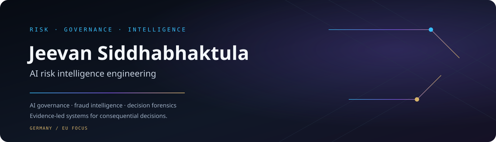
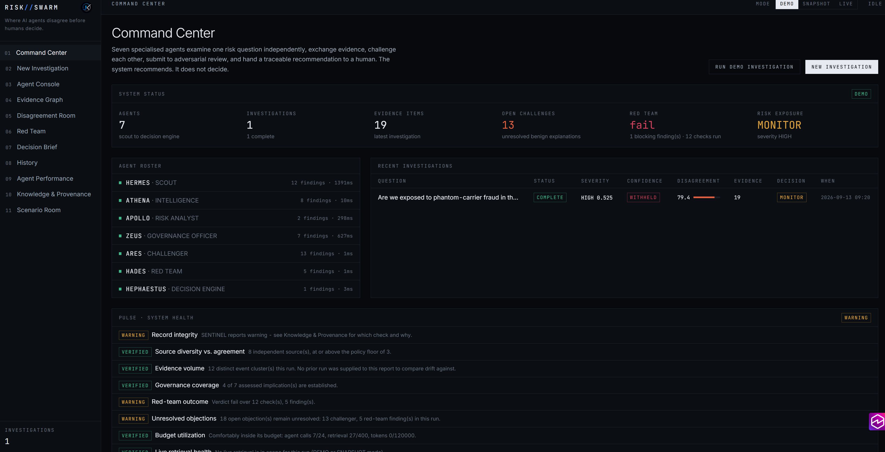

  

  <a href="https://jeevan-0508.github.io">Portfolio</a> ·
  <a href="https://www.linkedin.com/in/jeevan-siddhabhaktula-6927041a2/">LinkedIn</a> ·
  <a href="mailto:jeevansiddhabhaktula@gmail.com">Email</a>

# Building systems that make risk visible

I’m a former Amazon Risk Manager and Program Manager focused on **AI governance, AI risk, GRC,
responsible AI, fraud intelligence, and decision forensics**.

My work sits between operational risk and engineering: practical tools, explicit evidence, honest
boundaries, and interfaces that help people make better decisions.

`AI GOVERNANCE` · `RISK INTELLIGENCE` · `FRAUD SYSTEMS` · `GERMANY / EU`

## The portfolio

Six systems. One direction: make consequential decisions easier to inspect, challenge, and improve.

<table>
<tr>
<td width="50%" valign="top">

<h3><a href="https://github.com/Jeevan-0508/policy-audit">POLICY//AUDIT</a></h3>

Governance evidence traced from regulation to controls, implementation, contradictions, and gaps.

LOCAL · DETERMINISTIC 
<a href="https://jeevan-0508.github.io/policy-audit/">Live demo</a> · <a href="https://github.com/Jeevan-0508/policy-audit">Repository</a>
</td>
<td width="50%" valign="top">

<h3><a href="https://github.com/Jeevan-0508/risk-swarm">RISK//SWARM</a></h3>

Seven-agent investigation where disagreement, provenance, and red-team review stay visible.

SNAPSHOT DEMO · HUMAN DECISION 
<a href="https://jeevan-0508.github.io/risk-swarm/">Live demo</a> · <a href="https://github.com/Jeevan-0508/risk-swarm">Repository</a>
</td>
</tr>
<tr>
<td width="50%" valign="top">

<h3><a href="https://github.com/Jeevan-0508/fraud-watch">Fraud Watch</a></h3>

A synthetic freight world that turns evolving behaviour into signals, investigations, and analyst-reviewed outcomes.

SIMULATED · DETERMINISTIC 
<a href="https://jeevan-0508.github.io/fraud-watch/">Live demo</a> · <a href="https://github.com/Jeevan-0508/fraud-watch">Repository</a>
</td>
<td width="50%" valign="top">

<h3><a href="https://github.com/Jeevan-0508/risk-os">RISK//OS</a></h3>

A browser-first operating system for program risk, delivery decisions, controls, and benefits.

LOCAL · OFFLINE-FIRST 
<a href="https://jeevan-0508.github.io/risk-os/">Live demo</a> · <a href="https://github.com/Jeevan-0508/risk-os">Repository</a>
</td>
</tr>
<tr>
<td width="50%" valign="top">

<h3><a href="https://github.com/Jeevan-0508/risk-replay">RISK//REPLAY</a></h3>

Decision forensics and counterfactual replay for inspecting what changes when evidence or inputs change.

LOCAL API · STATIC DEMO 
<a href="https://jeevan-0508.github.io/risk-replay/">Live demo</a> · <a href="https://github.com/Jeevan-0508/risk-replay">Repository</a>
</td>
<td width="50%" valign="top">

<h3><a href="https://github.com/Jeevan-0508/ai-governance-control-room">AI Governance Control Room</a></h3>

An operator console for cross-framework coverage, evidence, controls, and governance exposure.

BROWSER-ONLY · CROSS-FRAMEWORK 
<a href="https://jeevan-0508.github.io/ai-governance-control-room/">Live demo</a> · <a href="https://github.com/Jeevan-0508/ai-governance-control-room">Repository</a>
</td>
</tr>
</table>

## What I bring

<table>
<tr>
<td width="50%" valign="top">
<strong>Risk and governance</strong> 
AI governance · operational risk · GRC · fraud intelligence · internal controls · evidence review · decision challenge
</td>
<td width="50%" valign="top">
<strong>Technical practice</strong> 
TypeScript · React · Python · deterministic systems · simulations · data provenance · browser-first tools · testable decision logic
</td>
</tr>
</table>

<strong>How I work</strong>

 

I separate evidence from claims, coverage from probability, replay from causation, and model output
from a human decision. Synthetic data is labelled. Provider failures are visible. The interface
should make those boundaries easy to understand.

<strong>Background</strong>

 

- Former Amazon Risk Manager and Program Manager
- Current focus: AI governance, AI risk engineering, responsible AI, GRC, and risk intelligence
- Open to relevant roles and collaborations in Germany and the EU

## Outside the core

Creative engineering lives in a separate lane: [Nightfall Zero](https://github.com/Jeevan-0508/nightfall-zero),
[HAKAI World](https://github.com/Jeevan-0508/hakai_world), [Scale of Everything](https://github.com/Jeevan-0508/scale-of-everything),
and [RuleShift](https://github.com/Jeevan-0508/ruleshift).

Evidence-led systems for consequential decisions.

